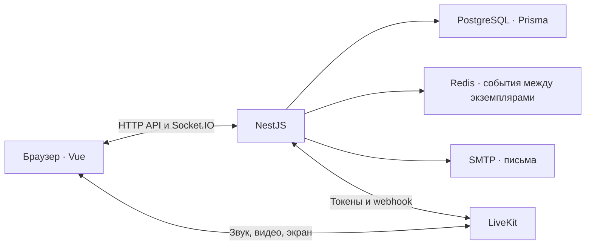

# Kontur Pulse

**Учебный сервис видеоконференций с опросами и голосованиями.** У проекта есть работающие интерфейс, API, база данных и видеосвязь. Встречу можно провести как с зарегистрированными пользователями, так и с гостями по ссылке.

**Рабочая версия:** [kontur-pulse-project.vercel.app](https://kontur-pulse-project.vercel.app) · **[Техническое задание](TZ_Kontyr_Pulse_MVP_v2.docx)**

## Возможности

| Раздел | Что реализовано |
| --- | --- |
| Аккаунт | Регистрация с подтверждением почты, вход, выход, восстановление пароля и изменение имени. |
| Встречи | Создание и редактирование встречи, плановая дата, запуск и завершение, ссылка для приглашения. Организатор может разрешить или запретить гостевой вход. |
| Конференция | Камера, микрофон, демонстрация экрана, список участников и работа на компьютере и телефоне. |
| Роли | Организатор, модератор и гость. Организатор назначает модераторов, может удалить участника или выключить ему микрофон. Право завершить встречу можно отдельно выдать модератору. |
| Опросы | Создание до и во время встречи, один или несколько вариантов ответа, обновление результатов в реальном времени. Участник может изменить ответ до закрытия опроса. |
| Голосования | Один окончательный бюллетень на участника. Состав допущенных фиксируется при открытии, итоги становятся доступны после закрытия. |

Данные аккаунтов, встреч, участников, опросов и голосований хранятся в PostgreSQL. Для событий в комнате используется Socket.IO, для аудио, видео и показа экрана — LiveKit.

## Как показать проект

1. Откройте [публичный сайт](https://kontur-pulse-project.vercel.app), зарегистрируйтесь и подтвердите почту по ссылке из письма.
2. Создайте встречу, запустите её и скопируйте гостевую ссылку.
3. Откройте ссылку во втором браузере или приватном окне и войдите гостем. В комнате будут видны оба участника.
4. Проверьте микрофон, камеру и демонстрацию экрана. Затем создайте опрос, ответьте из второго окна и посмотрите обновление результатов.
5. Откройте голосование, отправьте бюллетень, закройте голосование и посмотрите итог. Завершите встречу для всех.

Для проверки видеосвязи нужны доступ браузера к микрофону и камере и два устройства или два независимых окна. Если устройства находятся рядом, используйте наушники, чтобы звук из динамика не попадал в другой микрофон.

## Архитектура



| Часть | Технологии |
| --- | --- |
| Интерфейс | Vue 3, TypeScript, Vite, Pinia, Vuetify |
| Сервер | NestJS, TypeScript, Prisma |
| Хранение данных | PostgreSQL; Redis для обмена событиями между экземплярами сервера |
| Видеосвязь | WebRTC и LiveKit |
| Размещение | Vercel Services; в публичной версии используются облачные PostgreSQL, Redis и LiveKit |

## Локальный запуск через Docker

Нужны Git и Docker с поддержкой Compose (на Windows — запущенный Docker Desktop). Команды выполняются **из корня репозитория**, где находится `docker-compose.yml`:

```powershell
git clone https://github.com/itsInfect/kontur-pulse-project.git
cd kontur-pulse-project
docker compose up --build
```

После запуска доступны:

| Адрес | Назначение |
| --- | --- |
| [http://127.0.0.1:5173](http://127.0.0.1:5173) | Сайт |
| [http://127.0.0.1:8025](http://127.0.0.1:8025) | Mailpit: письма подтверждения и сброса пароля |
| [http://127.0.0.1:3000/api](http://127.0.0.1:3000/api) | Документация API (Swagger) |

Чтобы проверить регистрацию локально, создайте аккаунт на сайте, откройте письмо в Mailpit и перейдите по ссылке подтверждения. Затем войдите и проведите встречу по сценарию выше. Конфигурация Docker рассчитана на открытие сайта на **том же компьютере** через `127.0.0.1`; учётные данные в `docker-compose.yml` предназначены только для локальной разработки.

Остановить сервисы: `Ctrl+C`, затем `docker compose down`. Данные PostgreSQL сохраняются в Docker volume.

## Проверка и размещение

- В [GitHub Actions](.github/workflows/backend.yml) сервер проходит сборку, проверку кода и интеграционные тесты с PostgreSQL. Тесты покрывают вход и сессии, гостевой доступ, события, опросы, голосования и права участников.
- Сборка интерфейса проверяет TypeScript и создаёт production-версию командой `corepack pnpm build` в папке `frontend`.
- Публичный сайт развёрнут из этого репозитория на Vercel. Порядок подключения базы, Redis, LiveKit и почты описан в [руководстве по размещению](DEPLOYMENT.md). Секреты хранятся в настройках окружения Vercel и не должны попадать в Git.

## Границы проекта

Это учебный MVP, проверенный на основных сценариях. В нём нет записи встреч, встроенного чата, обмена файлами и календарных уведомлений. Должность, команда и поле «о себе» в профиле сохраняются только в текущем браузере; остальные основные данные хранятся на сервере. Нагрузочное тестирование и проверка работы при большом числе одновременных участников не проводились, поэтому заявленного лимита участников нет.

## Документация

- [Техническое задание MVP](TZ_Kontyr_Pulse_MVP_v2.docx)
- [Frontend: экраны и запуск](frontend/README.md)
- [Backend: API, события и тесты](backend/README.md)
- [Размещение публичной версии](DEPLOYMENT.md)
- [Исходный черновик ТЗ](Kratkoe_TZ_MVP_Videokonferencii.docx)
